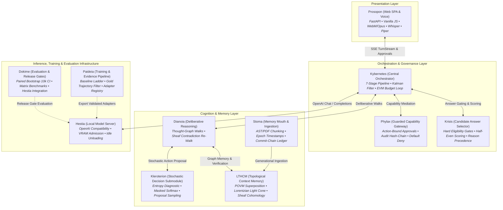

# Metis: Sovereign Local AI Cognitive & Multi-Agent Stack

**Metis** (Greek: *Μῆτις*, wisdom, counsel, craft) is a modular, single-owner, sovereign local AI ecosystem. It unites hierarchical non-Euclidean memory, deliberative graph-based thought traversal, local model serving, action-bound capability guardrails, policy-governed factual answer selection, reproducible statistical evaluation, and authenticated text and voice interfaces—**completely offline, with zero paid APIs, telemetry, or cloud lock-in.**

---

## 1. System Architecture



---

## 2. Component Stacks & Module Documentation

Each of the 11 component stacks in Metis is an independently testable module with explicit contracts, test suites, and dedicated documentation:

| Module | Architectural Role | Key Technologies & Capabilities | Documentation |
| :--- | :--- | :--- | :--- |
| **stoma** | Ingestion & Memory Mouth | Document parsing (PDF, text, code, OCR, transcripts), token bounding ($\le 254$), epoch-timestamped causal tagging, generational commit-chain durability, and honest monorepo provenance verification. | [**stoma/README.md**](stoma/README.md) |
| **LTHCM** | Topological Context Memory | Non-Euclidean memory substrate with Quantum POVM density operators, Lorentzian light-cone attention, Cellular Sheaf Laplacian contradiction filters, hyperbolic Poincaré taxonomy, and spectral wormhole routing. | [**LTHCM/README.md**](LTHCM/README.md) |
| **dianoia** | Deliberative Thought Walks | Graph traversal deliberative cognition over LTHCM (`EXPAND`, `BACKTRACK`, `ANSWER`), dual-model fallback proxy, sheaf contradiction re-walks, and versioned JSONL walk logging (`1.0.0`). | [**dianoia/README.md**](dianoia/README.md) |
| **kleroterion** | Stochastic Action Selector | Entropy-aware, dimension-scaled ($1/\sqrt{d}$) masked-softmax and Gaussian proposal selection for Dianoia walk actions, preventing cognitive mode collapse. | [**kleroterion/README.md**](kleroterion/README.md) |
| **hestia** | Local Model Serving | OpenAI-compatible server (`/v1/models`, `/v1/chat/completions`), VRAM admission control, idle model unloading, multi-model configs (`models.yaml`), and queue depth limiting. | [**hestia/README.md**](hestia/README.md) |
| **krisis** | Candidate Answer Selector | Deterministic eligibility gating (access, provenance, contradiction, citation resolution, claim support), 6-decimal Half-Even scoring, deduplication, and reason precedence. | [**krisis/README.md**](krisis/README.md) |
| **kybernetes** | Central Orchestrator | 7-stage de-siloed execution pipeline, real-time Bayesian-Kalman budget loop, EVM cost tracking, safe AST tools, action-bound Phylax gating, and SSE streaming. | [**kybernetes/README.md**](kybernetes/README.md) |
| **phylax** | Security Guardrails & Gateway | Point-of-action capability mediation, default-deny YAML policies, action-bound single-use approval state machine, anti-argument-swap verification, and fail-closed audit hash chain. | [**phylax/README.md**](phylax/README.md) |
| **prosopon** | UI & Sovereign Voice Client | Authenticated single-owner browser interface, PIN pairing, self-signed TLS for mobile microphone access, local audio transcoding (WebM $\to$ WAV $\to$ Whisper/Piper), and ShowWork drawer. | [**prosopon/README.md**](prosopon/README.md) |
| **paideia** | Training & Policy Pipeline | Evidence-to-policy pipeline, ladder of baselines (Majority $\to$ Regex $\to$ Lexical $\to$ Embedding), Dianoia gold defensible trajectory filtering, 10,000 paired bootstrap gates, and content-addressed adapter export. | [**paideia/README.md**](paideia/README.md) |
| **dokime** | Evaluation & Release Gates | Reproducible evaluation harness, 10,000 paired bootstrap confidence intervals, matrix benchmark runs, Hestia integration, immutable run manifests, and regression release gates. | [**dokime/README.md**](dokime/README.md) |

---

## 3. Cross-Module Architectural Contracts

To maintain strict interoperability and avoid runtime breakage, Metis enforces explicit cross-module contracts:

| Producer | Consumer | Interface / Contract | Invariant & Validation Rules |
| :--- | :--- | :--- | :--- |
| **Stoma** | **LTHCM** | `LTHCMEngine.index_document()` | - Single-facet shape `[1, 384]` enforced with loud `ShapeMismatchError`.<br/>- Real epoch timestamps (`time.time()`) to keep documents inside the past light cone.<br/>- Monorepo provenance verified via SHA-256 directory digests in `vendored_provenance.json`. |
| **LTHCM** | **Dianoia** | `LTHCMRetriever` | - Read-only inference with deterministic seed retrieval.<br/>- Sheaf cohomological contradiction filter triggers at most one corrective re-walk upon conflict. |
| **Dianoia** | **Kleroterion** | `StochasticProposalEngine` | - Action logits scaled by $1/\sqrt{d}$ before masked softmax.<br/>- Valid action masking prevents exploring visited or disconnected nodes. |
| **Dianoia** | **Paideia** | Walk Log JSONL (`~/.dianoia/walks.jsonl`) | - Schema version strictly `"1.0.0"`.<br/>- Linked re-walks share identical `walk_id`.<br/>- Unresolved contradictions or parse failures are excluded from gold policy sets. |
| **Paideia** | **Hestia** | Adapter Registry (`models.yaml`) | - Content-addressed SHA-256 digests computed strictly over immutable adapter weights and config files, omitting transient metadata timestamps. |
| **Kybernetes** | **Phylax** | `GuardedGateway` / `KybernetesShim` | - Action-bound state machine: `PENDING -> APPROVED -> EXECUTED`.<br/>- Approvals are single-use tokens consumed atomically upon execution.<br/>- Cryptographic argument digest verification prevents argument tampering. |
| **Kybernetes** | **Prosopon** | HTTP SSE (`/v1/chat/turn`) | - Typed `TurnEvent` streaming: `stage_start`, `stage_end`, `content_delta`, `approval_request`, `trace_complete`, `error`.<br/>- Redacted ShowWork metadata without leaking raw internal system prompts. |
| **Kybernetes** | **Krisis** | `KrisisSelector.evaluate()` | - Strict Half-Even Decimal 6-place scoring: $0.7 \cdot \bar{c} + 0.3 \cdot \text{cal\_ll}$.<br/>- Bracket citation validation (`[1]`, `[doc:123]`) against available evidence.<br/>- Hard gates eliminate unverified candidates before scoring. |

---

## 4. End-to-End Execution Flow

When a user asks a complex, multi-hop question via the Prosopon voice interface:

1. **Voice Ingestion**: The mobile browser captures push-to-talk audio via `MediaRecorder` (WebM/Opus) and sends it over a W3C-secure TLS connection to Prosopon.
2. **Audio Transcoding & STT**: Prosopon transcodes the audio to 16kHz mono WAV via local `ffmpeg` and transcribes it via local `whisper.cpp`.
3. **Turn Dispatch**: Prosopon opens an SSE stream to Kybernetes (`POST /v1/chat/turn`).
4. **Planning & Authorization**: Kybernetes checks tool permissions with Phylax and initializes the Bayesian-Kalman budget tracker.
5. **Memory Retrieval**: Kybernetes queries Stoma-indexed LTHCM memory within the Lorentzian past light cone.
6. **Deliberative Reasoning**: If multi-hop reasoning is required, Dianoia traverses the knowledge graph, choosing actions via Kleroterion's entropy-aware selector.
7. **Synthesis & Verification**: Hestia generates candidate responses. Krisis evaluates candidates against hard eligibility gates, checks citation markers, computes 6-decimal Half-Even scores, and selects the winning response.
8. **Guarded Action**: If an outbound action or tool is required, Phylax issues an interactive `ApprovalCard` to Prosopon; upon user confirmation, the single-use token is consumed and the tool executed.
9. **Streaming & Voice Playback**: Verified tokens and citations stream to Prosopon in real-time, followed by audio waveform playback synthesized locally via `piper`.

---

## 5. Getting Started & Workspace Setup

Metis is managed as a unified workspace using [`uv`](https://github.com/astral-sh/uv).

### Prerequisites
- Linux OS (Ubuntu 22.04+ recommended)
- Python 3.11 or 3.12
- `uv` installed (`curl -LsSf https://astral.sh/uv/install.sh | sh`)
- `ffmpeg` installed for voice features (`sudo apt-get install -y ffmpeg`)

### 1. Workspace Initialization
```bash
# Clone the repository
git clone https://gitlab.com/akarta-315h/metis.git
cd metis

# Bootstrap all virtual environments and workspace dependencies
./scripts/setup_workspace.sh

# Or directly with uv:
uv sync --python 3.12
```

### 2. Running Test Suites
```bash
# Multi-stack integration smoke test
PYTHONPATH="kybernetes:prosopon:hestia/src:stoma/src" uv run pytest tests/test_stack_smoke.py -v

# Regression suite covering cross-module fixes
uv run pytest tests/test_round2_fixes.py -v

# Individual stack unit tests
uv run pytest dianoia/tests -v
uv run pytest dokime/tests -v
uv run pytest hestia/tests -v
uv run pytest kleroterion/tests -v
uv run pytest krisis/tests -v
uv run pytest kybernetes/tests -v
uv run pytest paideia/tests -v
uv run pytest phylax/tests -v
uv run pytest prosopon/tests -v
uv run pytest stoma/tests -v
```

### 3. Launching the Sovereign Stack
```bash
# Launch Hestia (8080), Kybernetes (8081), and Prosopon (8000)
./scripts/run_stack.sh
```
Navigate to `http://127.0.0.1:8000` to interact with the system.

For phone access over your local Wi-Fi network:
```bash
prosopon serve --lan --tls --port 8000 --kybernetes-url http://127.0.0.1:8081/v1
```
Enter the 6-digit terminal pairing PIN on your phone browser (`https://<host-ip>:8000`) for authenticated text and push-to-talk voice.

---

## 6. Hardware & GPU Partitioning Guide

Metis is designed for efficient execution on heterogeneous local hardware with process isolation:

- **Inference & Model Serving (NVIDIA GeForce RTX 5060 Ti 16GB / Blackwell `sm_120`)**:
  - Dedicated to low-latency token generation for Llama-3.1-8B-Instruct via `llama-server` or vLLM (`CUDA_VISIBLE_DEVICES=1`).
- **Embeddings, NLI Verification & Tuning (NVIDIA Tesla V100 SXM2 16GB / Volta `sm_70`)**:
  - Dedicated to Stoma embeddings, Dokime/Krisis NLI verification, and Paideia tuning using Volta-compatible PyTorch builds (`CUDA_VISIBLE_DEVICES=0`).
- **Control Plane & Gate Evaluation (CPU Host)**:
  - Kybernetes, Krisis, Phylax, Prosopon, and SQLite budget engine run with minimal CPU and memory overhead (~500MB RAM).

For in-depth hardware setup, environment variables, driver configurations, and dual-driver boundaries, see [**docs/HARDWARE_AND_CUDA_GUIDE.md**](docs/HARDWARE_AND_CUDA_GUIDE.md).

---

## 7. Architecture Specifications & Integration Roadmap

- [**docs/ARCHITECTURE_AND_INTERCONNECT.md**](docs/ARCHITECTURE_AND_INTERCONNECT.md): Canonical reference manual detailing all 11 modules, CLI commands, cross-subsystem contracts, and dataflow topologies.
- [**docs/MSS.md**](docs/MSS.md): Metis Sovereign Stack (MSS) operational manual for autonomous coding agents, Lochos multi-agent squads, and Pinax tool catalogue.
- [**docs/STACK_BUILD_CONTRACT.md**](docs/STACK_BUILD_CONTRACT.md): Foundational build contract and component responsibilities.
- [**docs/HARDWARE_AND_CUDA_GUIDE.md**](docs/HARDWARE_AND_CUDA_GUIDE.md): Hardware allocation and multi-GPU partitioning guide.
- [**docs/review/pickup.md**](docs/review/pickup.md): Resumption guide, ambient systemd daemon management, and verified test totals.

---

## 8. License

Licensing, third-party dependency notices, and distribution permissions are managed per component and under owner review.
