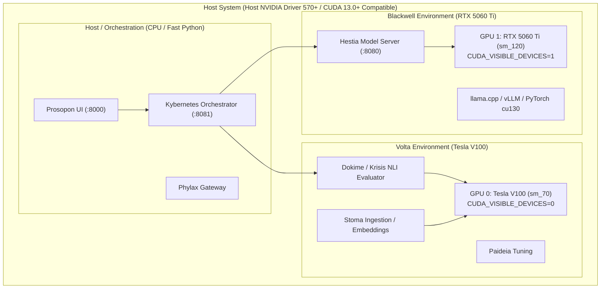

# Metis Hardware & CUDA Target Architecture Guide

## 1. Overview & Dual GPU Problem Statement

The Metis sovereign local AI stack is designed to run across sovereign workstation and server hardware. Deployments targeting heterogeneous GPU combinations—specifically combining **NVIDIA Tesla V100 (Volta)** with next-generation **NVIDIA GeForce RTX 5060 Ti (Blackwell)**—encounter a well-defined upstream PyTorch build boundary:

| GPU Model | Microarchitecture | Compute Capability | Primary Metis Workload |
| :--- | :--- | :--- | :--- |
| **NVIDIA Tesla V100** | Volta | `sm_70` | Embeddings, NLI verification (Dokime/Krisis), batch fine-tuning (Paideia) |
| **NVIDIA GeForce RTX 5060 Ti** | Blackwell | `sm_120` | Real-time LLM inference (Hestia / Llama 3.1 8B), INT4/FP8 quantization |

### Upstream PyTorch Wheel Incompatibility
Per upstream PyTorch release notes (PyTorch 2.12–2.14+):
- **CUDA 12.6 builds**: Include Volta (`sm_70`) through Hopper (`sm_90`), but do **not** support Blackwell (`sm_120`).
- **CUDA 13.0+ builds**: Support Blackwell (`12.0+PTX`), but drop support for Volta (`sm_70`).

**Key Takeaway**: *No single prebuilt PyTorch binary wheel natively spans both Volta (7.0) and Blackwell (12.0) architectures.* Attempting to run a single PyPI or CUDA 12 wheel across both cards will trigger `CUDA error: no kernel image is available for execution on the device` on either the V100 or the 5060 Ti.

---

## 2. Recommended Architecture: Component & Process Isolation

Rather than forcing a single monolithic Python environment across both GPUs, Metis components should be partitioned by hardware role and process isolation.



### Role Separation:
1. **Hestia (Inference Server - RTX 5060 Ti)**:
   - Dedicated to low-latency token generation for Llama-3.1-8B-Instruct.
   - Utilizes CUDA 13.0+ PyTorch wheels or standalone `llama-server` compiled with Blackwell tensor core kernels (`sm_120`).
   - Pin device: `CUDA_VISIBLE_DEVICES=1`.

2. **Stoma & Dokime (Ingestion & Verification - Tesla V100)**:
   - Dedicated to document embedding generation (e.g. `nomic-embed-text`), dense passage ranking, and NLI verification scoring.
   - Utilizes CUDA 12.6 PyTorch wheels compiled for Volta (`sm_70`).
   - Pin device: `CUDA_VISIBLE_DEVICES=0`.

3. **Kybernetes, Prosopon & Phylax (CPU Core Orchestration)**:
   - Lightweight, purely asynchronous control plane. Runs entirely on CPU in the root virtual environment.

---

## 3. Environment Provisioning & Installation

### A. Host Driver Requirement
Install host NVIDIA driver supporting CUDA 13.0+ (Driver version `>= 570.xx`). NVIDIA drivers are backward compatible with CUDA 12.6 userland containers and wheels.

### B. Installing PyTorch for Blackwell (RTX 5060 Ti)
For the Hestia inference virtual environment:
```bash
# In hestia virtual environment or container
uv pip install --upgrade torch torchvision --index-url https://download.pytorch.org/whl/cu130
```

Verify GPU visibility and compute capability:
```bash
CUDA_VISIBLE_DEVICES=1 python -c "import torch; print(torch.cuda.get_device_name(0), torch.cuda.get_device_capability(0))"
# Expected: NVIDIA GeForce RTX 5060 Ti (12, 0)
```

### C. Installing PyTorch for Volta (Tesla V100)
For Stoma, Dokime, and Paideia:
```bash
# In dokime / stoma virtual environment or container
uv pip install --upgrade torch torchvision --index-url https://download.pytorch.org/whl/cu126
```

Verify GPU visibility and compute capability:
```bash
CUDA_VISIBLE_DEVICES=0 python -c "import torch; print(torch.cuda.get_device_name(0), torch.cuda.get_device_capability(0))"
# Expected: Tesla V100-PCIE-16GB (7, 0)
```

---

## 4. Alternative: llama.cpp Multi-Architecture Binary

When running Hestia via the native `llama-server` C++ backend instead of PyTorch, compile `llama.cpp` with both architectures enabled:

```bash
git clone https://github.com/ggerganov/llama.cpp
cd llama.cpp
cmake -B build \
  -DGGML_CUDA=ON \
  -DCMAKE_CUDA_ARCHITECTURES="70;120"
cmake --build build --config Release -j$(nproc)
```

This generates a fat binary supporting both Volta FP16 matrix operations and Blackwell high-efficiency kernels.

---

## 5. Verification Checklist

Before starting production runs on heterogeneous hardware, verify:
- [ ] Host driver `>= 570.xx` via `nvidia-smi`.
- [ ] `CUDA_VISIBLE_DEVICES` explicitly declared in `scripts/run_stack.sh` or systemd service units.
- [ ] Hestia reports healthy connection to `:8080` without CUDA kernel errors.
- [ ] Kybernetes doctor reports clean reachability:
  ```bash
  uv run kybernetes doctor
  ```
