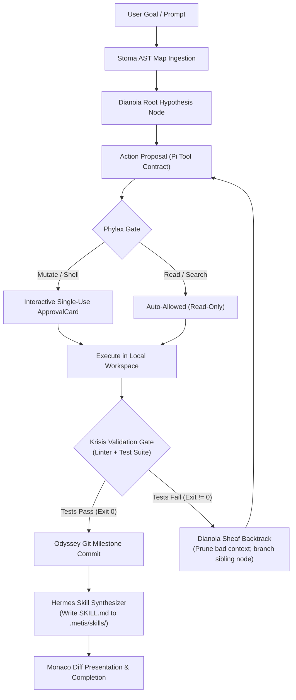

# Metis Sovereign Coding Agent & Workbench Harness Specification
**Document ID:** `METIS-HARNESS-ARCH-001`  
**File:** `harness/harness.md` (historical alias: `hardness.md`)  
**Status:** Approved Architectural Blueprint  
**Subsystems:** `prosopon` (Presentation/UI), `kybernetes` (Orchestration), `phylax` (Guardrails), `stoma` (Ingestion), `LTHCM` (Memory), `dianoia` (Reasoning), `hestia` (Inference)

---

## 1. Executive Summary & Design Vision

Metis is evolving from a conversational multi-agent stack into an **autonomous sovereign coding environment**. Rather than adopting naive, bloated function-calling wrappers ("quick-and-dirty" agents) that suffer from prompt bloat, context drift, and unverified diffs, the **Metis Coding Harness** synthesizes the proven architectural breakthroughs of the industry's four leading harnesses:

1. **Pi Agent (Mario Zechner)**: Minimalist tool contracts (`read`, `write`, `edit_block`, `bash`), a hyper-lean ~2k-token system prompt, and **tree-structured session branching** instead of linear context stuffing.
2. **Nous Research Hermes Agent**: **Dynamic self-evolving skills** (`.md` files written upon successful problem resolution and retrieved dynamically) and cross-session persistent memory.
3. **Odyssey / AgentOdyssey**: **Milestone state checkpointing** and verification rollback, preventing long-horizon context drift across extended debugging tasks.
4. **Aider / SWE-agent**: **Tree-sitter AST symbol repo-mapping** ($\le 1,500$ tokens) and **exact-anchor search/replace block editing** to eliminate broken unified diffs.
5. **Metis Native Superpowers**: **Phylax action-bound cryptographic approvals**, **Dianoia deliberative graph walks** with non-poisoning backtracks, **LTHCM topological context memory**, and **Krisis regression gates**.

The interface adopts the **Antigravity / VS Code frame**: an activity bar with navigational views, a Monaco code and side-by-side diff editor, a bottom terminal/diagnostics dock, a right-side deliberative thought and agent drawer, and an **Antigravity/VS Code style Settings Panel** governing all local Metis subcomponents.

---

## 2. Synthesis Matrix: Adopting the Best Features

| Harness Feature | Source Architecture | Metis Implementation | Benefit & Impact |
| :--- | :--- | :--- | :--- |
| **Lean Tool Surface** | **Pi Agent** | 4 atomic tools: `read_range`, `write_file`, `edit_block`, `sandboxed_bash`. | Leaves 95%+ of context budget for actual source code and compiler outputs. |
| **Tree-Structured Sessions** | **Pi Agent** + **Dianoia** | Branching conversation tree (`node_id`, `parent_id`, `branch`). | Prunes failed attempts and tracebacks out of the active context, preventing model confusion. |
| **Self-Improving Skills** | **Nous Hermes** | `.metis/skills/<domain>/SKILL.md` dynamically authored upon test pass. | Re-uses proven recipes (build flags, test setups) across runs without re-discovering them. |
| **Milestone Checkpointing** | **Odyssey** | Git tree state snapshots before each agent turn; instant rollback on test failure. | Completely prevents runaway file corruption during multi-step refactoring. |
| **AST Repo-Mapping** | **Aider** + **Stoma** | Stoma parses AST definitions; LTHCM serves a PageRank-weighted symbol graph. | Model navigates multi-file repos with zero blind context guessing in $<1,500$ tokens. |
| **Exact-Anchor Editing** | **Aider** | Search-and-replace anchor blocks (`<<<< SEARCH ... ==== ... >>>> REPLACE`). | 0% patch syntax errors compared to standard `diff -u` unified diffs. |
| **Action-Bound Gating** | **Phylax** | Single-use cryptographic tokens consumed atomically on mutating file/shell operations. | Prevents unapproved destructive commands (`rm`, force resets) or argument tampering. |
| **Regression Gating** | **Krisis** + **Dokime** | Deterministic 6-decimal Half-Even scoring and pytest/mypy validation before user presentation. | Guarantees code compiles and tests pass before proposing a patch. |

---

## 3. The 4-Tool Core Contract (Pi-Derived)

All coding operations in [kybernetes](file:///home/akarta/Projects/Metis/kybernetes) are constrained to four deterministic primitives registered in `kybernetes/tools/registry.py`:

### Tool 1: `read_file_range`
```json
{
  "name": "read_file_range",
  "description": "Read file lines with 1-indexed numbering and total file line counts. Bounded to max 250 lines per call.",
  "parameters": {
    "type": "object",
    "required": ["path"],
    "properties": {
      "path": {"type": "string", "description": "Workspace relative file path"},
      "start_line": {"type": "integer", "description": "Starting line number (1-indexed)", "default": 1},
      "end_line": {"type": "integer", "description": "Ending line number (inclusive)", "default": 200}
    }
  }
}
```
*Outputs lines prefixed with `line_no:hash| content` (FNV-1a 4-hex-char hashline anchors) to eliminate drift.*

### Tool 2: `edit_file_block` (Hashline-Anchored Replacement & Diagnostics)
```json
{
  "name": "edit_file_block",
  "description": "Precisely replace a block of code using exact matching or hashline anchors ('line:hash|'). Validates stale-anchor rejection to prevent file drift. Automatically executes in-process syntax checks and returns diagnostic feedback.",
  "parameters": {
    "type": "object",
    "required": ["path", "search_block", "replace_block"],
    "properties": {
      "path": {"type": "string", "description": "Workspace relative file path"},
      "search_block": {"type": "string", "description": "Exact text or hashline-prefixed text to find including context lines"},
      "replace_block": {"type": "string", "description": "Exact replacement text"},
      "expected_start_hash": {"type": "string", "description": "Optional 4-hex-char anchor hash of the first line"},
      "expected_end_hash": {"type": "string", "description": "Optional 4-hex-char anchor hash of the last line"}
    }
  }
}
```

### Tool 3: `write_file`
```json
{
  "name": "write_file",
  "description": "Atomically create a new file or completely rewrite an existing file. Requires explicit Phylax approval for overwrites.",
  "parameters": {
    "type": "object",
    "required": ["path", "content"],
    "properties": {
      "path": {"type": "string", "description": "Workspace relative file path"},
      "content": {"type": "string", "description": "Full file content"},
      "overwrite": {"type": "boolean", "default": false}
    }
  }
}
```

### Tool 4: `sandboxed_bash`
```json
{
  "name": "sandboxed_bash",
  "description": "Execute a non-interactive shell command with bounded timeout, output head/tail truncation, and Phylax capability validation.",
  "parameters": {
    "type": "object",
    "required": ["command"],
    "properties": {
      "command": {"type": "string", "description": "Shell command line to execute"},
      "timeout_seconds": {"type": "integer", "default": 30, "maximum": 120}
    }
  }
}
```

---

## 4. Cognition & Memory: Dianoia Tree-Search + Hermes Learning



### Dianoia Tree-Search Invariant:
When an edit causes a test or linter failure, the full error stack trace is **not** concatenated into the root chat history. Instead:
1. Dianoia records the failure constraint as metadata on the failed leaf node.
2. The working directory is rolled back via git to the parent checkpoint.
3. Dianoia branches a sibling node with an injected constraint: `[Constraint: Previous attempt failed in test_auth.py: line 42 with KeyError('token'). Re-examine token generation.]`.
4. This preserves an untainted context window.

---

## 5. Antigravity & VS Code Workbench Architecture

The presentation layer in [prosopon](file:///home/akarta/Projects/Metis/prosopon) transforms from a standalone chat stream into a modular **Antigravity / VS Code Workbench Frame**:

```
+---+-----------------------------------------------------------------------------------------------+
|   | [Metis] [Workspace: /Metis] [Branch: main]   [Hestia: Qwen 2.5 Coder 32B] (Local) [● PTT Mic] |
+---+-----------------------------------------------------------------------------------------------+
| A | SIDEBAR (300px)     | CENTER WORKBENCH (Monaco Editor / Diff View)       | METIS AGENT PANEL  |
| C | [Explorer]          | +------------------------------------------------+ | [Dianoia Walk Tree]|
| T | v metis             | | pairing.py [x] | registry.py [x] | DIFF [+]    | | - Step 1: Search   |
| I |   > kybernetes      | +------------------------------------------------+ | - Step 2: Read AST |
| V |   v prosopon        | 1: import hmac                                   | | - Step 3: Patch    |
| I |     pairing.py      | 2: import hashlib                                | |                  |
| T |     server.py       | 3:                                               | | [Chat Stream]    |
| Y |   > phylax          | 4: def verify_pairing(pin: str, hash: str) -> ...| | "I've refactored |
|   |   > stoma           |                                                  | | pairing.py with  |
| B | ------------------- | [SPLIT DIFF EDITOR WHEN AGENT PROPOSES PATCH]    | | timing-safe HMAC"|
| A | [Open Editors]      | - old_val = pin == stored_pin                    | |                  |
| R | pairing.py          | + new_val = hmac.compare_digest(pin, stored_pin) | | [Phylax Token]   |
|   |                     |                                                  | | [✓ Approve] [✗]  |
|   +---------------------+--------------------------------------------------+--------------------+
|   | BOTTOM PANEL: [Terminal] [Problems: 0] [Phylax Audit Log] [Dokime Benchmarks] [Memory Graph]   |
|   | $ pytest tests/test_pairing.py -> 14 passed in 0.42s                                          |
+---+-----------------------------------------------------------------------------------------------+
```

### 1. The Activity Bar (Far Left Nav Bar)
Contains vertical iconic selectors with active indicators and tooltips:
- **Explorer (`Ctrl+Shift+E`)**: File tree, open editor tabs, workspace outlines.
- **Search & Symbols (`Ctrl+Shift+F`)**: AST-aware symbol search, ripgrep queries.
- **Source Control (`Ctrl+Shift+G`)**: Git status, pending diffs, branch management.
- **Metis Agent (`Ctrl+Shift+A`)**: Autonomous coding agent session, thought graph, budget gauge.
- **Memory & Graph (`Ctrl+Shift+M`)**: LTHCM Poincaré hyperbolic graph viewer and Stoma causal ingestion queue.
- **Release & Eval (`Ctrl+Shift+D`)**: Dokime paired-bootstrap 10k evaluation gates and benchmark runners.
- **Settings (`Ctrl+,`)**: Antigravity / VS Code style centralized configuration panel.

### 2. The Center Workbench (Monaco Core)
- **Multi-Tab Monaco Editor**: High-performance editing with syntax highlighting, code folding, minimap, and bracket matching.
- **Split Diff Viewer**: Triggered automatically when the agent proposes an edit. Highlights additions in green and deletions in red side-by-side.
- **Inline Phylax Actions**: Direct "Approve & Commit Patch" and "Reject & Backtrack" action buttons embedded above the diff.

### 3. The Bottom Panel Dock
Tabbed container with slide-up resizing:
- **Terminal**: Embedded local terminal session via WebSockets.
- **Problems**: Real-time linters (ruff, mypy) diagnostic messages.
- **Phylax Audit Trail**: Chronological hash-chain ledger of all granted tool permissions, parameter SHA-256 digests, and consumed tokens.
- **Dokime Benchmarks**: Live progress bars and confidence intervals for local model regression tests.

---

## 6. Antigravity & VS Code Style Settings System

Settings are no longer hidden across disparate `.yaml` files. The Workbench provides a unified, searchable **Settings GUI** designed identically to Antigravity and VS Code:

### Layout:
- **Header**: Search bar (`Search settings...`), "Modified" filter, and "Open raw settings (YAML/JSON)" shortcut.
- **Left Category Nav**:
  - `General & Appearance` (Theme, font family, ligatures, minimap)
  - `Hestia Models & Inference` (Active coding model, VRAM budget, quantization, idle timeout)
  - `Kybernetes Engine` (Tool timeouts, max recursion depth, Kalman filter budget limits)
  - `Phylax Security & Policies` (Default-deny rules, safe directory roots, shell execution whitelist)
  - `LTHCM Memory & Context` (Past light-cone bounds, Poincaré dimension, sheaf Laplacian thresholds)
  - `Prosopon Voice & Audio` (Whisper model, Piper voice persona, PTT threshold)
- **Main Area**: Rich interactive configuration cards:
  - Boolean switches (e.g., `Phylax: Require manual approval for git commits`)
  - Dropdown selectors (e.g., `Hestia Model: Qwen-2.5-Coder-32B-Instruct-Q4_K_M`)
  - Number sliders with live readout (e.g., `Kalman Budget Alpha: 0.85`)
  - Path inputs with directory picker (e.g., `Workspace Root: /home/akarta/Projects/Metis`)
  - Direct synchronization with `config.py`, `models.yaml`, and `policies/default_deny.yaml`.

---

## 7. Implementation Roadmap & Milestones

1. **Phase 1: Harness Specification & Contracts** (Completed)
   - Written `harness/hardness.md` and `harness/harness.md`.
   - Cloned and indexed `earendil-works/pi` and `NousResearch/hermes-agent` references.
2. **Phase 2: Kybernetes 4-Tool Core Engine**
   - Implement `read_file_range`, `edit_file_block`, `write_file`, and `sandboxed_bash` in `kybernetes/tools/`.
   - Add Phylax capability policies to `phylax/policies/coding_agent.yaml`.
3. **Phase 3: Dianoia Checkpointing & Tree Backtracking**
   - Integrate git milestone checkpoints and sheaf-theoretic backtracking for test failures.
4. **Phase 4: Prosopon Antigravity/VS Code Workbench**
   - Upgrade Prosopon web frontend with Monaco Editor, Side-by-Side Diff Editor, Activity Bar, and the VS Code Settings Panel.
